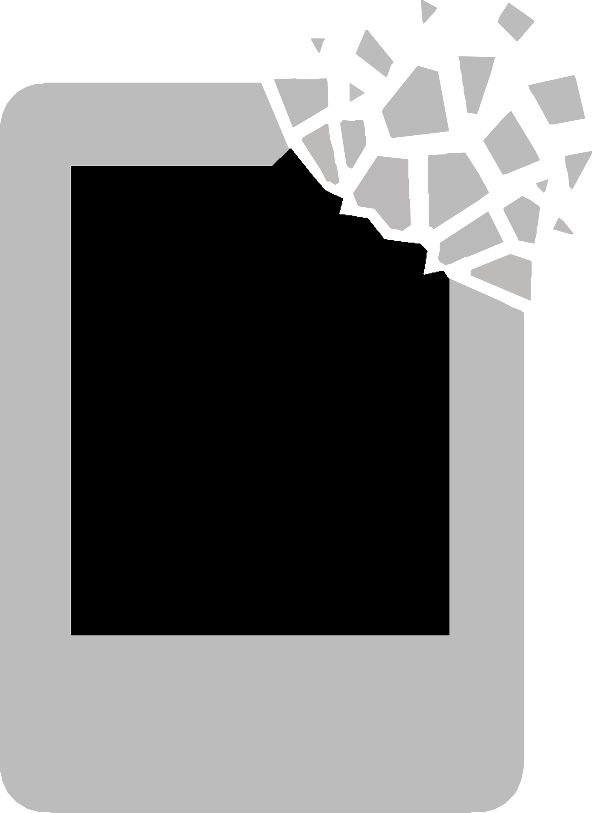

  

<h1 align="center">Foto Nerve Shatter</h1>

<em>I hope you never have to use this. But if you do, I hope it helps.</em>

This web app recursively scans directories for corrupt, truncated, or damaged image and video files. For images, it attempts recovery where possible. Also extracts EXIF metadata with thumbnail previews across an entire directory.

Built for data recovery scenarios where hundreds or thousands of photos have been rescued from a failing drive but many are partially damaged. The scanner identifies every problem file, categorizes the damage, and offers one-click repair or salvage for supported image formats.

## Quick Start

Requires Python 3.12+. Everything else installs itself on first launch into a `.venv/` in the project folder, which takes 5 to 30 seconds. Foto Nerve Shatter runs as a local web server at [http://localhost:5900](http://localhost:5900) and opens your browser when it starts.

- **macOS:** double-click **`FotoNerveShatter.app`** in the project folder. Double-click it again to stop it or reopen the browser.
- **Linux:** from the project folder, run `./server.sh start` (stop with `./server.sh stop`).
- **Windows:** from the project folder, run `python app.py` (use `py app.py` if `python` isn't found). Press **Ctrl+C** to stop.

Gatekeeper prompts on another Mac, changing the port, the full requirements list and the rest are in [Getting started](docs/getting-started.md).

## Documentation

Full documentation lives in the [`docs/`](docs/) folder:

| Page | What it covers |
| --- | --- |
| [Getting started](docs/getting-started.md) | Starting and stopping on macOS, Linux and Windows, first launch, requirements |
| [Features](docs/features.md) | Feature overview and the supported formats table |
| [Issue types](docs/issue-types.md) | What each status means, how it's decided, RAW tail damage, corruption percentage |
| [Recovery techniques](docs/recovery.md) | Repair JPEG, Salvage Image, and Export Preview in detail |
| [EXIF Info](docs/exif.md) | Using Exif Info, what the cards show, the integrity check, how metadata, thumbnails, and previews are read, CSV export |
| [Blur check](docs/blur-check.md) | Scoring, the AI quality model, installing and publishing it, limitations |
| [Lightbox preview](docs/lightbox.md) | Full-screen preview and zoom, and how previews are rendered |
| [Supported formats](docs/supported-formats.md) | Which extensions are scanned, how each format family is validated, optional libraries, adding a format |
| [Architecture](docs/architecture.md) | Code layout (backend modules, frontend scripts), startup, API endpoints, request flow, concurrency, privacy |
| [Logging](docs/logging.md) | Where the server's output goes and how to read it |

## License

This project is licensed under the [MIT](LICENSE.md) License. See the [LICENSE.md](LICENSE.md) file for details. ExifTool isn't bundled; when the app downloads it, it's under ExifTool's own license (the same terms as Perl). The AI quality model is non-commercial only (see [Blur check](docs/blur-check.md#ai-assisted-scoring)).
