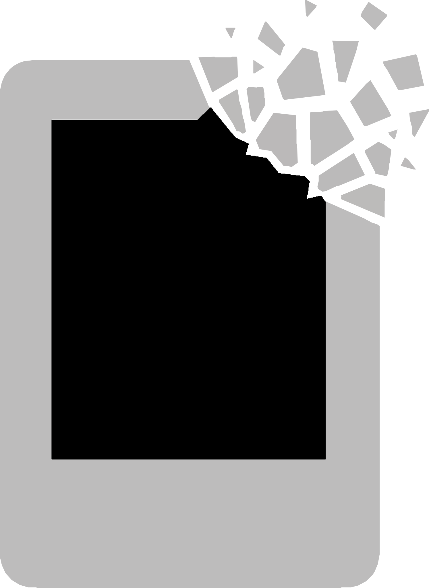

<p align="center">
  
</p>

<h1 align="center">Foto Nerve Shatter</h1>

<p align="center">
  <i>I hope you never have to use this. But if you do, I hope it helps.</i>
  
  This web app recursively scans directories for corrupt, truncated, or damaged image and video files. For images, it attempts recovery where possible. Also extracts EXIF metadata
with thumbnail previews across an entire directory.
  
  Built for data recovery scenarios where hundreds or thousands of photos have been rescued from a failing drive but many are partially damaged. The scanner identifies every problem file, categorizes the damage, and offers one-click repair or salvage for supported image formats.
</p>

## Features

- **Recursive scanning** with real-time progress via Server-Sent Events
- **Folder-grouped results** with filtering by issue type
- **Repair JPEG**: re-encodes truncated JPEGs while preserving EXIF metadata and ICC profiles
- **Salvage Image**: recovers JPEGs with destroyed headers (missing SOI) using donor-table grafting and MCU-level remapping
- **Export Preview**: extracts embedded JPEG previews from RAW files that can't be fully decoded
- **EXIF Info**: scans every image and video for metadata (camera, date, settings, GPS coordinates, dimensions) and displays it as a lazy-loaded thumbnail card grid grouped by folder
- **Blur Check**: scores every photo for blur (0 = sharp, 100 = very blurry) without mistaking bokeh for blur, using a sharpness measure plus an optional AI quality model, with a threshold slider to decide what counts as blurry
- **Volume mount detection**: detects when a drive is mounted/unmounted in real time and shows a status indicator
- **Previous scans**: last 10 scans persisted to IndexedDB; restore any previous scan from a dropdown without rescanning
- **CSV export** of scan results, EXIF data, and blur scores
- **Directory browser** with breadcrumb navigation
- **Reveal in Finder/Explorer**: jump to any file from the UI

## Supported Formats

| Category | Extensions |
|----------|-----------|
| JPEG | `.jpg` `.jpeg` `.jpe` `.jfif` |
| PNG | `.png` |
| HEIC/HEIF | `.heic` `.heif` |
| TIFF | `.tif` `.tiff` |
| RAW | `.nef` `.nrw` `.arw` `.srf` `.sr2` `.cr2` `.cr3` `.dng` `.raf` `.rw2` `.orf` `.pef` `.srw` |
| Other | `.webp` `.bmp` `.gif` |
| Video | `.mp4` `.m4v` `.mov` `.avi` `.mpg` `.mpeg` |

How each format is checked: [Supported formats](docs/supported-formats.md).

## Starting and Stopping

Foto Nerve Shatter runs as a local web server at [http://localhost:5900](http://localhost:5900) and opens your browser when it starts. Missing dependencies are installed automatically on first run, so the first launch can take a minute.

### macOS

Double-click **`FotoNerveShatter.app`** in the project folder. Foto Nerve Shatter starts in the background (no Terminal window) and your browser opens.

- **First launch:** if macOS asks whether Foto Nerve Shatter can access your Downloads folder or a removable volume, click **Allow**. Foto Nerve Shatter needs this to scan your photos.
- **On another Mac:** if macOS says *"Apple could not verify FotoNerveShatter is free of malware"*, or the app says it *can't find its project folder* (or `sh: ./app.conf: No such file or directory`), that's Gatekeeper: the launchers are signed locally, not notarized by Apple, so macOS blocks copies that arrive by download, AirDrop, or zip. Either:
  - **Rebuild the launchers on that Mac (recommended).** In Terminal, from the project folder, run `launcher/build-app.sh` once. Launchers built on the Mac itself aren't blocked.
  - **Or clear the quarantine flag** without rebuilding: in Terminal, from the project folder, run `xattr -dr com.apple.quarantine .`

  System Settings' **Open Anyway** isn't enough on its own: it gets past the warning, but macOS then runs the app from a temporary copy where it can't find `app.conf` and `server.sh`.
- **To stop it or reopen the browser:** double-click FotoNerveShatter.app again. A dialog says Foto Nerve Shatter is already running and offers **Open in Browser** or **Stop Foto Nerve Shatter**. If you keep another copy of the project and launch the app from there, it detects the running instance on the configured port and shows the same dialog.
- **Dock shortcut:** drag FotoNerveShatter.app onto the Dock. Keep the app itself in the project folder, because it uses `server.sh` next to it.

Prefer a Terminal window? Double-click **FotoNerveShatter.command** instead; it starts Foto Nerve Shatter from a Terminal window, and pressing Return there stops it. You can also use the `server.sh` commands below (`./server.sh logs` follows the server log; see [Logging](docs/logging.md)).

### Linux

From the project folder:

```bash
./server.sh start         # start in the background and open the browser
./server.sh stop          # stop it
./server.sh status        # check whether it's running
./server.sh logs          # follow the server log
./server.sh restart
```

Add a port number to `start` or `restart` (e.g. `./server.sh start 8080`) to use a different port. Alternatively, edit `app.conf` (`PORT=5900`) so FotoNerveShatter.app and `server.sh` share the same setting.

### Windows

From the project folder in Command Prompt or PowerShell:

```bash
python app.py             # start (use "py app.py" if "python" isn't found)
python app.py 8080        # start on a different port
```

Leave the window open while you use Foto Nerve Shatter, and press **Ctrl+C** in it to stop. (Under WSL, use the Linux instructions.)

## Requirements

- Python 3.10+
- Pillow
- numpy (Blur Check)
- onnxruntime (optional: Blur Check's AI quality model)

No external web framework is needed; it uses Python's built-in `http.server`.

Optional, but installed automatically along with the rest:

- **rawpy**: full RAW format support (NEF, ARW, CR2, CR3, DNG, RAF, RW2, ORF, PEF, SRW)
- **pillow-heif**: HEIC/HEIF support (iPhone photos)

Minimum versions are in [`requirements.txt`](requirements.txt). To install everything manually:

```bash
pip install -r requirements.txt
```

## Issue Types

| Status | Meaning |
|--------|---------|
| **Partial** | File is truncated, so image data is incomplete. Repair may help. |
| **Corrupt** | Invalid headers, missing SOI marker, or destroyed structure. Salvage may help for JPEGs. |
| **EXIF Only** | File contains metadata but no recoverable image content. |
| **Empty** | File is 0 bytes. |
| **Unsupported** | Format requires an optional library that isn't installed. |
| **Error** | Permission denied or unexpected I/O error. |

How each status is decided, and the corruption percentage: [Issue types](docs/issue-types.md).

## Recovery Techniques

### Repair JPEG

For **truncated** JPEGs where the header is intact but the file was cut short. The repair decodes all surviving pixel data using Pillow's truncation-tolerant mode, preserves the original EXIF metadata and ICC color profile, and re-encodes as a structurally clean JPEG. The result opens in any viewer without errors.

### Salvage Image

For **corrupt** JPEGs where the beginning of the file has been zeroed out (missing SOI marker). Three strategies are tried in order:

1. **Embedded tables**: if the file's own DQT/DHT/SOF0 tables survived, just prepend the SOI marker. This produces a perfect reconstruction with no data loss.

2. **Donor grafting + MCU remap**: finds a working JPEG from the same directory, extracts its quantization and Huffman tables, grafts them onto the surviving compressed data, then remaps MCU blocks to their correct grid positions using RST marker alignment. Recovers 80-95% of the image depending on how much data was zeroed.

3. **Simple graft**: for files without restart markers, grafts donor tables and decodes what's available. Content appears at the top; unrecoverable data is gray.

### Export Preview

For **RAW files** that can't be fully decoded, extracts the embedded JPEG preview that most cameras store inside the RAW container. This is typically a full-resolution JPEG that the camera generated at capture time.

More detail, including which action fits which status: [Recovery techniques](docs/recovery.md).

## EXIF Info

Click **Exif Info** to scan every image and video in a directory for metadata. Results appear as a card grid grouped by folder. Each card shows:

- Thumbnail (lazy-loaded as you scroll, so it handles 10k+ files efficiently)
- Camera make and model
- Capture time
- Exposure settings (aperture, shutter speed, ISO, focal length)
- Image dimensions and file size
- GPS coordinates (clickable link to Google Maps, when available)

Supports JPEG, PNG, HEIC, TIFF, WebP, and RAW formats. Videos show a placeholder icon. Click a thumbnail or filename to reveal the file in Finder / Explorer.

Each file also gets the same integrity check as Scan Directory: damaged files get a red **Damaged** tag (hover for the exact problem), are counted in the summary, and the CSV export includes Integrity columns. The check fully decodes every file, including RAW sensor data, so Exif Info is slower on RAW-heavy folders (125 NEFs: about 60 seconds instead of 15).

How metadata and thumbnails are read: [EXIF Info](docs/exif.md).

## Blur Check

Click **Blur Check** to score every photo in a directory for blur. Results appear as a thumbnail grid grouped by folder, blurriest first, each with a blur score from **0 (sharp)** to **100 (very blurry)**.

- **Blur threshold slider:** photos scoring at or above it count as blurry; by default only those are shown. Moving it re-filters instantly (no rescan), and the setting is remembered. **Default** resets it to 50.
- **Show all photos** lists every photo, with the blurry ones outlined in red.
- **Score colors:** green below 15, yellow from 15 to 49, red at 50 or above (fixed bands, whatever the slider is set to).
- **Low detail** marks photos with too little texture to judge focus (fog, sky, plain walls).
- **Export CSV** saves every photo's score, its components, and whether it's blurry at the current threshold.

### AI-assisted scoring

Blur Check combines two measurements:

1. **A sharpness measure** (always available): the variance of the Laplacian, scored by the photo's sharpest region so a sharp subject on a soft, out-of-focus background (bokeh) still counts as sharp, checked in every direction to catch camera shake, and contrast-normalized so dark photos aren't penalized. It's good at blur specifically, but its scale depends on the scene: a crisp portrait has less edge detail than crisp carved stone, so one threshold doesn't fit every folder.
2. **An AI quality model** (optional, recommended): **CLIP-IQA+**, a trained image-quality model that judges photos the way people do across cameras and scenes. On its own it also marks dark photos down, which is why it's combined with the sharpness measure rather than used alone.

A third check catches photos that look ordinary to both: ones smeared by camera shake, soft low-resolution exports, or heavy phone noise reduction can keep plenty of edge contrast while losing nearly all fine detail. When a photo's sharpest areas have almost no fine detail (measured in the frequency domain), it's flagged, unless the AI model rates the photo above average (some phones' own processing leaves sharp photos with little fine detail too).

Before scoring, dark photos are brightened (shadows lifted most, like raising exposure in an editor), because underexposure is fixable in post-processing and shouldn't count as blur. This happens on an in-memory copy; files are never modified.

The two scores are standardized against a reference library and blended, with the AI model weighted 60% and the sharpness measure 40% (the AI model judges bokeh portraits and smeared zooms better; the sharpness measure catches real softness the AI model can miss, and isn't fooled by dark photos). The default threshold of 50 sits on the boundary between photos the owner judged sharp and photos they judged blurry (41 photos from 11 cameras, 2001 to 2025). On an 851-photo curated iPhone/Nikon D810 library, 17 photos (2%) are flagged at the default.

**Installing the model:** the first Blur Check without it shows **Basic scoring** with a **Download model** button (146 MB, one time). The app downloads it with `curl`, verifies its SHA-256 checksum, and stores it in `models/`. It needs `onnxruntime`, which the app installs automatically on startup (optional: if that install fails, Blur Check keeps using basic scoring).

**Speed:** about 0.25 s per photo with the AI model (an 851-photo folder takes under 4 minutes), versus about 15 seconds for the whole folder with basic scoring.

**License:** the model file is **not** covered by this project's MIT license. It combines OpenAI's CLIP image encoder (MIT) with learned prompts from pyiqa (PolyForm Noncommercial), so it's for **non-commercial use only**. See [`models/MODEL_LICENSE.md`](models/MODEL_LICENSE.md).

#### Publishing the model (maintainers)

The 146 MB model is too big for git, so it's distributed as a GitHub release file:

1. Build it (or use the copy in `models/`): see the instructions at the top of [`tools/export_quality_model.py`](tools/export_quality_model.py). It needs PyTorch in a throwaway virtual environment, checks that the exported model reproduces pyiqa exactly, and prints the file's SHA-256, which must match `QUALITY_MODEL_SHA256` in `backend/blur/quality_model.py`.
2. Create a GitHub release tagged `quality-model-v1` and attach `models/clipiqa_plus_rn50.onnx` and `models/MODEL_LICENSE.md`.
3. `QUALITY_MODEL_URL` in `app.conf` already points at that release file.

**Limitations:** neither measurement knows what you *meant* to focus on, so a photo with the background in focus and the subject soft can count as sharp. Intentional softness (long-exposure water, mist, haze) can score as blurry. The calibration rests on a small set of photos the owner judged (41 from 11 cameras) plus one large library, so if the default doesn't match your eye, the slider is the fix. RAW files are scored from their embedded full-size preview when there is one. When the preview is too small (e.g. iPhone DNGs), a same-name JPEG/HEIC saved alongside it (RAW+JPEG shooting) is scored instead; without one, the sensor data is decoded and lightly sharpened to approximate the camera's processing. The card's tooltip says which was used.

## How It Works

The backend is a Python HTTP server (built on `http.server`, no framework) with a thread pool (4 workers) for parallel file checking. `app.py` is only the entry point: it installs missing dependencies and starts the server. The application lives in `backend/`:

| Module | What it does |
|---|---|
| `server.py` | HTTP handler: serves the frontend and the `/api/` endpoints |
| `integrity/` | Integrity checks, one module per format family (`jpeg`, `png`, `heic`, `raw`, `video`, `generic`), and `check_integrity()`, which every scan uses |
| `scan.py` | Scan Directory and the pre-scan media count |
| `exif.py`, `thumbnails.py` | EXIF extraction and the Exif Info scan; card thumbnails |
| `blur/` | Blur Check: `calibration.py` (every tunable number), `loading.py`, `sharpness.py`, `quality_model.py`, `score.py`, `scan.py` |
| `tiff.py` | TIFF structure parsing and embedded RAW preview extraction |
| `repair.py` | JPEG salvage |
| `config.py`, `formats.py`, `jobs.py` | Paths and `app.conf`, supported extensions, scan cancellation |

The frontend is `index.html`, `css/styles.css`, and plain scripts in `js/`, one per feature (`scan.js`, `exif.js`, `blur.js`, `browse.js`, `history.js`, `recovery.js`, `mount.js`), with shared helpers in `core.js` and startup in `main.js`. No build step, no node_modules, no framework dependencies.

Scan results stream to the browser in real time via SSE. Each file is validated by a format-specific checker that examines container structure (headers, markers, atoms) and attempts a full Pillow decode. Previous scans are persisted to IndexedDB (last 10) and listed in the Previous scans dropdown; picking one loads it.

Module responsibilities, every API endpoint, and the concurrency model: [Architecture](docs/architecture.md).

## Documentation

| Doc | Covers |
|---|---|
| [Architecture](docs/architecture.md) | Code layout (backend modules, frontend scripts), startup, API endpoints, request flow, concurrency, privacy |
| [Supported formats](docs/supported-formats.md) | Which extensions are scanned, how each format family is validated, optional libraries, adding a format |
| [Issue types](docs/issue-types.md) | What each status means, how it's decided, RAW tail damage, corruption percentage |
| [Recovery techniques](docs/recovery.md) | Repair JPEG, Salvage Image, and Export Preview in detail |
| [EXIF Info](docs/exif.md) | What the cards show, the integrity check, how metadata and thumbnails are read, CSV export |
| [Logging](docs/logging.md) | Where the server's output goes and how to read it |

## License

MIT
